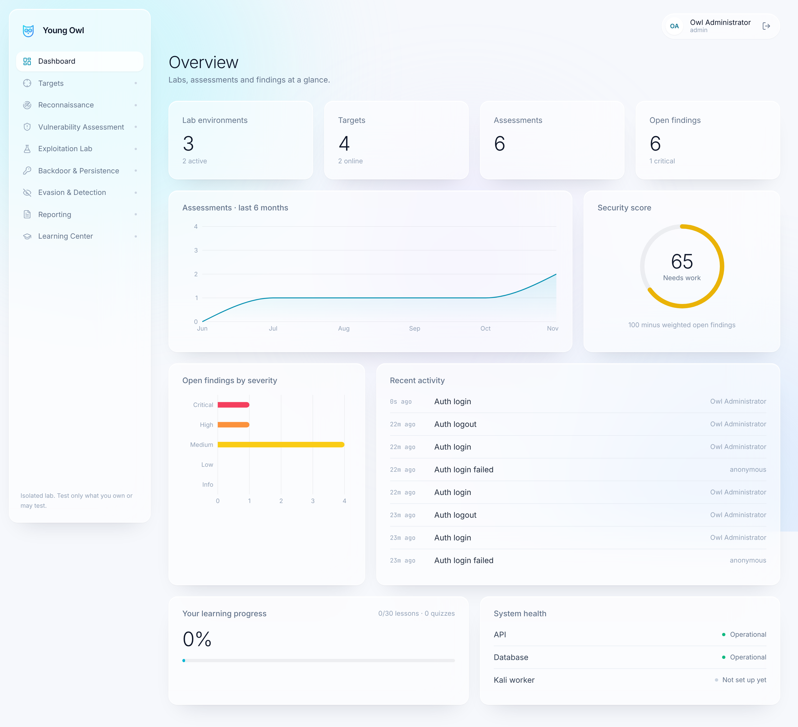

# YoungOwl

Own custom WebApp for supporting my Hacking Labs.

Young Owl is a cybersecurity learning platform and penetration-testing laboratory: a Next.js control
center, a REST API, a PostgreSQL database with dummy data, and (from Phase 3) a Kali Linux worker that
runs approved tools against intentionally vulnerable targets in an isolated network.

> ⚠️ Use only against the lab targets shipped with this project or systems you own / have written
> permission to test.



## Status

| Phase | What | State |
|---|---|---|
| 0 | Design docs | ✅ |
| 1 | Foundation: monorepo, database + seed, auth/RBAC API, dashboard | ✅ |
| 2 | Backend API: targets, labs, assessments, reports | next |
| 3 | Kali worker + isolated lab network | planned |
| 4 | Learning modules | planned |
| 5 | PDF reports, analytics, monitoring, HTTPS deploy | planned |

See [docs/roadmap.md](docs/roadmap.md).

## Repository layout

```text
apps/web        Next.js frontend (App Router, Tailwind, Recharts, Framer Motion)
apps/api        Fastify REST API (Zod, sessions, CSRF, RBAC, rate limiting, audit log)
apps/worker     Kali security job worker (Phase 3)
packages/database  Prisma schema, migrations, seed
packages/shared    Shared types, Zod schemas, permissions
infrastructure/    Dockerfiles (and later Kali image, lab targets, Nginx)
docs/              Architecture, API spec, threat model, roadmap
```

## Try it in GitHub Codespaces (no install)

[](https://codespaces.new/rayhadifjri/YoungOwl)

1. Click the badge (or **Code → Codespaces → Create codespace**). Pick the `feat/phase-1-foundation`
   branch until it is merged into `main`.
2. Wait for setup to finish (first time about 3–5 minutes): it installs packages, starts
   PostgreSQL, loads the dummy data and builds the app.
3. The app opens on port **3000**. If it doesn't, open the **Ports** tab and click the globe icon
   next to port 3000.
4. Log in with `admin@youngowl.lab` / `Owl-Admin-2026!`.

The port is private by default, so only your GitHub account can open it. Codespaces is a dev
sandbox: don't run the Kali lab (Phase 3+) there. Logs are in `.devcontainer/logs/`. After code
changes, rebuild with `bash .devcontainer/setup.sh && bash .devcontainer/start.sh`.

## Run with Docker (VPS or local)

Needs Docker with the Compose plugin.

```bash
git clone https://github.com/rayhadifjri/YoungOwl.git && cd YoungOwl
cp .env.example .env
# Edit .env: set strong POSTGRES_PASSWORD, REDIS_PASSWORD and SEED_*_PASSWORD values.
# For the first start, set SEED_ON_START=true to load the dummy data, then set it back to false.
docker compose up -d --build
```

The web app listens on `127.0.0.1:3000` only. On a VPS, open it through an SSH tunnel until HTTPS
is set up in Phase 5:

```bash
ssh -L 3000:localhost:3000 you@your-vps
# then browse to http://localhost:3000
```

Update later with `git pull && docker compose up -d --build`.

## Local development

Needs Node 22, pnpm 10 and PostgreSQL 16 (or `docker compose up -d postgres` with the port line
uncommented in `docker-compose.yml`).

```bash
pnpm install
cp .env.example .env               # adjust DATABASE_URL
pnpm --filter @young-owl/shared build
pnpm db:migrate                    # create tables
pnpm db:seed                       # dummy data
pnpm dev                           # web on :3000, api on :4000
```

### Seed accounts (dummy, change before any real use)

| Email | Role | Password (from `.env`) |
|---|---|---|
| admin@youngowl.lab | ADMIN | `SEED_ADMIN_PASSWORD` |
| researcher@youngowl.lab | RESEARCHER | `SEED_RESEARCHER_PASSWORD` |
| student@youngowl.lab | STUDENT | `SEED_STUDENT_PASSWORD` |

### Tests

```bash
pnpm typecheck
pnpm test          # API tests need the seeded database
```

## Documentation

- [Architecture](docs/architecture.md)
- [API specification](docs/api-specification.md)
- [Threat model](docs/threat-model.md)
- [Roadmap](docs/roadmap.md)
- [Database schema](packages/database/prisma/schema.prisma)
- [Original requirements (master prompt)](docs/master-prompt.md)
