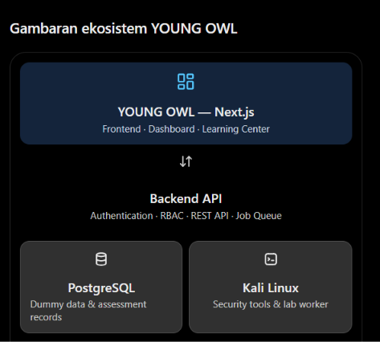

# Young Owl — System Architecture

Status: **Draft v0.1** (Step 1 of the plan, for review before any code is written)
Source requirements: [`master-prompt.md`](master-prompt.md)

## 1. Overview

Young Owl is a cybersecurity learning platform and penetration-testing laboratory. Learners pick an
intentionally vulnerable target that runs in an isolated lab network, launch approved tools (Nmap,
Nikto, …) from a Kali Linux worker, and see results, findings and reports in a Next.js dashboard.



```
                Internet
                   │  443 (HTTPS only)
             ┌─────▼─────┐
             │   Nginx    │  TLS, rate limit, security headers
             └─────┬─────┘
          edge_net │
     ┌─────────────┴──────────────┐
┌────▼────┐   /api/* proxy   ┌────▼────┐
│  web    │ ───────────────► │  api    │  Fastify + Zod + RBAC
│ Next.js │                  └─┬────┬──┘
└─────────┘          core_net  │    │
                    ┌──────────┘    └──────────┐
              ┌─────▼─────┐             ┌──────▼─────┐
              │ PostgreSQL│             │   Redis    │  BullMQ job queue + pub/sub
              └─────▲─────┘             └──────▲─────┘
                    │ results                  │ jobs
                    │        ┌─────────────────┴──┐
                    └────────┤ worker (Kali image)│  allowlisted tools only
                             └─────────┬──────────┘
                     lab_net (internal: true, no internet, no route to core)
                    ┌──────────────────┼──────────────────┐
              ┌─────▼─────┐      ┌─────▼─────┐      ┌─────▼─────┐
              │ juice-shop│      │   dvwa    │      │  …more    │
              └───────────┘      └───────────┘      └───────────┘
```

## 2. Components

| Component | Tech | Responsibility |
|---|---|---|
| `apps/web` | Next.js (App Router), React, TypeScript, Tailwind, shadcn/ui, Recharts, Framer Motion | UI: dashboard, targets, labs, learning center, reports. No secrets, no direct DB or shell access. |
| `apps/api` | Node.js, Fastify, Zod, Prisma | Auth, RBAC, REST API, scope checks, job creation, audit logs, SSE stream of job progress. |
| `apps/worker` | Node.js (TypeScript) on a Kali Linux base image | Consumes jobs from the queue, runs **allowlisted** tools with validated arguments, parses output, writes results. |
| `packages/database` | Prisma + PostgreSQL | Schema, migrations, seed script with dummy data. |
| `packages/shared` | TypeScript + Zod | Shared types, request/response schemas, tool allowlist definitions. |
| `packages/ui` | React | Reusable UI components (tables, terminal view, severity badges, charts). |
| `infrastructure/` | Docker Compose, Nginx | Networks, container limits, vulnerable lab images, monitoring. |
| Redis | BullMQ | Job queue between api and worker; pub/sub for live progress. |

**Why a separate API instead of only Next.js Route Handlers?** The spec allows both. A separate
Fastify service keeps the security boundary clear: the web container never holds DB credentials or
queue access, the API can be rate-limited and documented (OpenAPI) on its own, and the worker contract
lives in one place.

## 3. Main flow: running a scan (spec §7)

1. User logs in (session cookie, `httpOnly`, `Secure`, `SameSite=Strict`).
2. User opens a target in **Target Management** and chooses a tool profile, e.g. `nmap.service-scan`.
3. `web` calls `POST /api/v1/assessments/:id/jobs` with `{ toolProfile, targetId }`.
4. `api` checks: authenticated, role has `job:create`, target belongs to an active lab the user may use,
   target host is inside the lab scope (lab CIDR / hostname allowlist), rate limit not exceeded.
5. `api` creates a `scan_results` row (status `QUEUED`), writes an audit log entry, enqueues a BullMQ job
   that contains **only IDs and a profile name**, never a command string.
6. `worker` loads the profile from the allowlist in `packages/shared`, resolves the target host from the
   DB, re-validates scope, builds an argv array (`execFile`, never a shell), and runs it with a timeout,
   CPU/memory limits and a read-only filesystem except for a scratch dir.
7. `worker` streams progress lines over Redis pub/sub, then stores raw output + parsed findings.
8. Results and new `vulnerabilities` rows are saved in PostgreSQL.
9. `web` shows progress live via Server-Sent Events from `GET /api/v1/jobs/:id/stream`.

### Tool allowlist (initial)

| Profile | Tool | Arguments (fixed template) | Timeout |
|---|---|---|---|
| `nmap.discovery` | nmap | `-sn {cidr}` | 120 s |
| `nmap.service-scan` | nmap | `-sV -T4 --top-ports 1000 -oX - {host}` | 600 s |
| `nikto.basic` | nikto | `-h {url} -Format json -o -` | 900 s |
| `gobuster.dir` | gobuster | `dir -u {url} -w /wordlists/common.txt -q` | 600 s |
| `whatweb.fingerprint` | whatweb | `--log-json=- {url}` | 120 s |

`{host}`, `{url}` and `{cidr}` come from the target record, never from user input. Heavier tools
(SQLMap, Hydra, Metasploit) are added in Phase 4+ with their own profiles, stricter limits, and only
against targets flagged `allowsIntrusive = true`.

## 4. Network and container isolation

| Network | Members | Notes |
|---|---|---|
| `edge_net` | nginx, web, api | Only nginx publishes a port (443, and 80 for redirect). |
| `core_net` | api, postgres, redis, worker | Not published. Postgres/Redis never exposed on the VPS. |
| `lab_net` | worker, vulnerable targets | `internal: true` → no internet, not reachable from outside the host. |

- Vulnerable targets **never publish ports** to the VPS and are **not** on `edge_net` or `core_net`.
- Worker: non-root user, `cap_drop: [ALL]` plus only `NET_RAW`/`NET_ADMIN` needed by nmap,
  `read_only: true`, `tmpfs` scratch, `mem_limit`, `cpus`, `pids_limit`, no Docker socket.
- Next.js never runs commands and never gets root on Kali (spec §7).
- Lab targets can be reset (recreated) per lab session.

## 5. Data model summary

See [`../packages/database/prisma/schema.prisma`](../packages/database/prisma/schema.prisma).
The 15 required tables: `users, roles, permissions (+ role_permissions join), laboratories, targets,
assessments, vulnerabilities, scan_results, learning_modules, lessons, quizzes, quiz_results, reports,
audit_logs, lab_sessions`. A `sessions` table holds login sessions.

## 6. Roles (RBAC)

| Role | Can |
|---|---|
| `ADMIN` | Everything, incl. users, roles, labs, allowlist toggles, audit logs. |
| `INSTRUCTOR` | Manage labs, targets, learning content; view all assessments. |
| `RESEARCHER` | Run assessments and jobs on assigned labs, write findings and reports. |
| `STUDENT` | Learning center, quizzes, run beginner-level jobs in their own lab sessions. |

Permissions are strings like `target:read`, `job:create`, `report:export`, checked in the API.

## 7. Learning content boundaries

Modules F (backdoor & persistence) and G (evasion & exit) are **conceptual and detection-focused**, as
required by the spec: theory, architecture diagrams, artefact analysis, log/IOC exercises, and
"find and remove the planted persistence" blue-team labs. The platform does not ship working
implants, hidden access, log wiping, covert exfiltration or AV/EDR evasion tooling.

## 8. Folder structure

```text
young-owl/
├── apps/
│   ├── web/                 # Next.js frontend (App Router)
│   │   └── src/{app,components,features,lib}
│   ├── api/                 # Fastify REST API
│   │   └── src/{modules/<name>/{routes,service,schema}.ts, plugins, lib}
│   └── worker/              # Security job worker (Kali image)
│       └── src/{runner,parsers,profiles}
├── packages/
│   ├── database/            # Prisma schema, migrations, seed
│   ├── shared/              # Zod schemas, types, tool profiles
│   └── ui/                  # Reusable UI components
├── infrastructure/
│   ├── docker/              # Dockerfiles, compose overrides
│   ├── kali-linux/          # Worker image
│   ├── vulnerable-labs/     # Target definitions (Juice Shop, DVWA, …)
│   ├── nginx/
│   └── monitoring/
├── docs/
│   ├── architecture.md
│   ├── api-specification.md
│   ├── threat-model.md
│   ├── roadmap.md
│   └── master-prompt.md
├── docker-compose.yml
├── .env.example
├── pnpm-workspace.yaml
├── turbo.json
└── README.md
```

Tooling: pnpm workspaces + Turborepo, Vitest for unit tests, Playwright for E2E, ESLint + Prettier.

## 9. Deployment target

A single Ubuntu VPS running Docker Compose. Nginx (or Traefik) terminates TLS with Let's Encrypt.
Secrets come from a `.env` file on the server that is not committed. Code is deployed by
`git pull && docker compose up -d --build`. Recommended size: 4 vCPU / 8 GB RAM / 60 GB disk.
