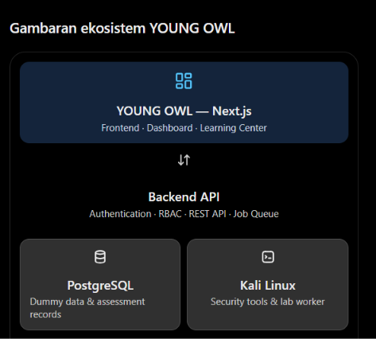

# PROJECT YOUNG OWL
## Master Prompt untuk Claude Code

**Peran Claude:** Bertindak sebagai Senior Full-Stack Engineer, Cybersecurity Architect, Penetration Testing Specialist, dan UI/UX Designer.

Saya ingin membangun proyek besar bernama **YOUNG OWL**, yaitu platform pembelajaran dan simulasi keamanan siber yang mengintegrasikan aplikasi Next.js sebagai pusat kendali, backend API, database dummy, serta Kali Linux sebagai lingkungan pengujian keamanan.

Proyek ini digunakan untuk pembelajaran, eksperimen, simulasi serangan, pengujian kerentanan, dan evaluasi keamanan secara terstruktur. Seluruh pengujian harus dibatasi pada sistem laboratorium yang dimiliki atau mendapatkan izin tertulis.

---

## 1. Tujuan utama

YOUNG OWL harus:

1. Menjadi platform pembelajaran cybersecurity interaktif.
2. Menyediakan lingkungan simulasi penetration testing.
3. Mempraktikkan identifikasi dan pengujian kerentanan pada aplikasi laboratorium.
4. Menjelaskan konsep backdoor melalui simulasi aman dan analisis malware.
5. Mengajarkan persistence, privilege escalation, dan defense evasion melalui demonstrasi terisolasi dan berorientasi deteksi.
6. Mengajarkan incident response dan digital forensics.
7. Mengintegrasikan Next.js dengan Kali Linux.
8. Menyediakan target aplikasi dummy yang sengaja rentan.
9. Menghasilkan laporan pengujian keamanan.

## 2. Technology stack

### Frontend
- Next.js App Router
- React dan TypeScript
- Tailwind CSS
- Shadcn/UI
- Lucide Icons
- Recharts
- Framer Motion

### Backend
- Next.js Route Handlers atau backend Node.js terpisah
- REST API
- Zod validation
- Authentication dan authorization

### Database
- PostgreSQL
- Prisma ORM
- Dummy seed database

### Cybersecurity environment
- Kali Linux
- Docker dan Docker Compose
- Nmap
- Burp Suite Community
- OWASP ZAP
- Nikto
- SQLMap
- Metasploit Framework
- Wireshark
- Gobuster
- Hydra hanya pada target autentikasi laboratorium

### Infrastructure
- Ubuntu Server
- Docker
- Nginx atau Traefik
- Environment variables
- Logging dan monitoring

## 3. Arsitektur aplikasi

Bangun arsitektur modular yang terdiri dari:

- **Frontend:** antarmuka pengguna YOUNG OWL.
- **Backend API:** pengelolaan data, autentikasi, dan komunikasi antarmodul.
- **Database:** menyimpan akun, target simulasi, hasil scan, laporan, dan progres belajar.
- **Lab Engine:** mengelola lingkungan target yang terisolasi.
- **Kali Linux Integration:** menjalankan tool pengujian melalui worker/API yang aman.
- **Reporting Engine:** menghasilkan laporan assessment.

Jangan menjalankan command terminal secara langsung dari request frontend. Gunakan worker backend dengan command allowlist, validasi parameter, autentikasi, dan pembatasan hak akses.

### Gambaran ekosistem YOUNG OWL

Gunakan diagram berikut sebagai referensi visual arsitektur tingkat tinggi YOUNG OWL. Pertahankan hubungan antara frontend Next.js, Backend API, PostgreSQL, dan Kali Linux ketika merancang arsitektur teknis. Diagram ini merupakan gambaran awal; detail implementasi tetap harus dijelaskan dalam dokumentasi arsitektur.




## 4. Modul frontend

### A. Dashboard
- Total laboratory environments.
- Total security assessments.
- Statistik kerentanan.
- Aktivitas terbaru.
- Progres pembelajaran.
- Kesehatan sistem.
- Security score.

### B. Target Management
- Daftar target aplikasi dummy.
- Informasi IP dan domain laboratorium.
- Jenis aplikasi.
- Status target.
- Tingkat kesulitan.
- Tombol menjalankan assessment.

### C. Reconnaissance
Materi dan simulasi:
- Network discovery.
- Port scanning.
- Service enumeration.
- DNS enumeration.
- Subdomain discovery.
- Technology fingerprinting.

### D. Vulnerability Assessment
Materi:
- SQL Injection.
- Cross-Site Scripting (XSS).
- IDOR.
- CSRF.
- SSRF.
- Authentication vulnerabilities.
- Security misconfiguration.
- File upload vulnerabilities.

### E. Exploitation Laboratory
Sediakan latihan terisolasi:
- SQL Injection pada database dummy.
- XSS pada aplikasi target.
- Authentication bypass dalam lab.
- Privilege escalation pada container latihan.
- Eksploitasi kerentanan aplikasi web yang sengaja dibuat rentan.

### F. Backdoor & Persistence Learning
Buat modul yang menjelaskan:
- Konsep dan arsitektur backdoor.
- Reverse shell dan bind shell secara konseptual.
- Mekanisme persistence.
- Scheduled task dan startup mechanisms.
- Command-and-control architecture.
- Detection dan forensic investigation.
- Identifikasi serta penghapusan persistence yang tidak sah.

Praktik hanya berupa simulasi terisolasi dengan agen uji yang terlihat, persetujuan eksplisit, dan mekanisme penghentian. Jangan membuat akses tersembunyi atau mekanisme yang menghindari persetujuan pemilik sistem.

### G. Evasion & Exit Learning
Buat materi edukasi tentang:
- Konsep defense evasion.
- Log tampering sebagai pola ancaman.
- Anti-forensics.
- Indikator data exfiltration.
- Network traffic obfuscation.
- Incident response.
- Detection engineering.

Fokus praktik pada deteksi, analisis artefak, dan simulasi defensif. Jangan menyediakan fitur penghapusan jejak, eksfiltrasi tersembunyi, atau penghindaran deteksi pada sistem nyata.

### H. Reporting
- Assessment history.
- Detail vulnerability.
- Severity classification.
- CVSS score.
- Evidence.
- Rekomendasi remediation.
- Export PDF.

### I. Learning Center
- Materi pembelajaran.
- Tutorial.
- Hands-on laboratory.
- Quiz.
- Progress tracking.
- Level Beginner, Intermediate, dan Advanced.

## 5. Backend API

Buat REST API modular untuk:
- Authentication.
- User management.
- Target management.
- Laboratory management.
- Reconnaissance.
- Vulnerability assessment.
- Learning progress.
- Reporting.
- Audit logs.
- System monitoring.

Setiap API harus memiliki:
- Input validation.
- Error handling.
- Authentication.
- Authorization.
- Rate limiting.
- Structured logging.
- API documentation.

## 6. Dummy database

Gunakan PostgreSQL dan Prisma. Buat minimal tabel:
1. users
2. roles
3. permissions
4. laboratories
5. targets
6. assessments
7. vulnerabilities
8. scan_results
9. learning_modules
10. lessons
11. quizzes
12. quiz_results
13. reports
14. audit_logs
15. lab_sessions

Sediakan:
- Prisma schema.
- Migration.
- Seed script.
- Dummy administrator.
- Dummy researcher.
- Dummy targets.
- Dummy vulnerability records.
- Dummy assessment history.

Jangan menggunakan kredensial produksi atau data pribadi sungguhan.

## 7. Integrasi Kali Linux

Buat mekanisme integrasi antara Next.js dan Kali Linux dengan alur:

1. User login ke YOUNG OWL.
2. User memilih target laboratorium.
3. Frontend mengirim permintaan ke backend.
4. Backend memverifikasi hak akses dan scope target.
5. Backend mengirim pekerjaan ke worker.
6. Worker menjalankan tool Kali Linux yang diizinkan.
7. Hasil dikembalikan ke backend.
8. Hasil disimpan ke database.
9. Frontend menampilkan hasil secara real-time.

Gunakan Docker untuk mengisolasi target dan worker. Batasi jaringan laboratorium, CPU, memori, durasi proses, serta akses filesystem. Jangan memberikan akses root Kali Linux kepada proses Next.js.

## 8. UI/UX design

Gunakan arah desain enterprise cybersecurity:
- Dark navy background.
- Accent cyan dan electric blue.
- Typography modern.
- Sidebar navigation.
- Interactive charts.
- Terminal-style interface.
- Responsive layout.
- Clean data tables.
- Professional security visualization.

Hindari tampilan dashboard template yang terlalu sederhana.

## 9. Security requirements

Aplikasi YOUNG OWL sendiri harus menerapkan:
- Secure authentication.
- Role-based access control (RBAC).
- Password hashing.
- CSRF protection.
- XSS protection.
- SQL injection prevention.
- Input validation.
- Secure session management.
- Secrets management.
- Audit logging.
- Rate limiting.
- Network isolation.
- Container isolation.

Sertakan threat model dan dokumentasi security architecture.

## 10. Development roadmap

### Phase 1 — Foundation
- Setup Next.js.
- Setup PostgreSQL.
- Setup Prisma.
- Setup authentication.
- Setup frontend dashboard.
- Setup dummy data.

### Phase 2 — Backend
- REST API.
- Target management.
- Laboratory management.
- Assessment history.
- Reporting.

### Phase 3 — Cybersecurity Modules
- Reconnaissance.
- Vulnerability assessment.
- Exploitation laboratory.
- Backdoor analysis.
- Persistence simulation.
- Evasion detection.
- Incident response.

### Phase 4 — Kali Linux Integration
- Docker worker.
- Kali Linux integration.
- Job queue.
- Scan execution.
- Real-time result monitoring.

### Phase 5 — Advanced Features
- Automated security assessment.
- Vulnerability analytics.
- Learning management system.
- PDF reporting.
- System monitoring.

## 11. Instruksi implementasi

Sebelum coding:
1. Buat dokumentasi arsitektur sistem.
2. Buat folder structure.
3. Buat database schema.
4. Buat API specification.
5. Buat roadmap implementasi.
6. Identifikasi dependency antarfitur.

Kemudian implementasikan secara bertahap dengan ketentuan:
- Jangan membuat seluruh aplikasi dalam satu file.
- Gunakan clean architecture.
- Gunakan reusable components.
- Pisahkan frontend, backend, dan lab worker.
- Gunakan TypeScript secara konsisten.
- Pastikan setiap modul dapat diuji.
- Jangan menggunakan data dummy yang hanya berupa tampilan statis.
- Setiap fitur harus memiliki alur kerja nyata.
- Sertakan README.md.
- Sertakan .env.example.
- Sertakan Docker Compose.
- Sertakan dokumentasi instalasi dan deployment.

**Instruksi akhir untuk Claude:**

Mulailah membangun YOUNG OWL dari fondasi proyek yang benar. Prioritaskan aplikasi yang benar-benar berjalan, bukan sekadar mockup UI.

Jangan mengimplementasikan semua modul sekaligus. Selesaikan setiap phase, lakukan testing, dokumentasikan hasilnya, kemudian lanjutkan ke phase berikutnya.

YOUNG OWL harus menjadi platform cybersecurity learning dan penetration testing laboratory yang modular, scalable, terintegrasi dengan Kali Linux, dan dapat dikembangkan dalam jangka panjang.

---

## Rekomendasi struktur direktori

```text
young-owl/
├── apps/
│   ├── web/                 # Next.js frontend
│   ├── api/                 # Backend API
│   └── worker/              # Security job worker
├── packages/
│   ├── database/            # Prisma & PostgreSQL
│   ├── shared/              # Shared types & schemas
│   └── ui/                  # Reusable UI components
├── infrastructure/
│   ├── docker/
│   ├── kali-linux/
│   ├── vulnerable-labs/
│   └── monitoring/
├── docs/
│   ├── architecture.md
│   ├── api-specification.md
│   ├── threat-model.md
│   └── roadmap.md
├── docker-compose.yml
└── README.md
```

